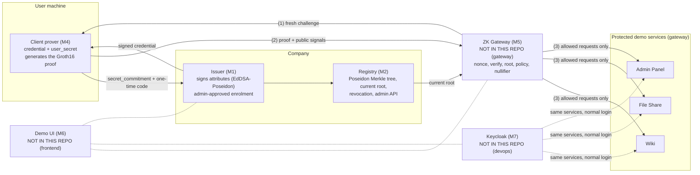

# ZK Access Gate

A zero-trust gateway that lets employees into internal services by **proving they meet the
access policy, without telling the gateway who they are**. Each user holds a credential the
company signed. For every request, the user's machine generates a zero-knowledge proof (Groth16)
that the credential is valid, not revoked and satisfies the resource's policy, and that the
proof is bound to the gateway's fresh challenge. The gateway checks the proof in milliseconds and
learns only *allowed* or *denied*. A normal Keycloak SSO login guards the same services as a
comparison baseline, so the demo can show what each one learns.

Full scope: [`docs/project-scope.md`](docs/project-scope.md). Plain-language background:
[`docs/technology-explained.md`](docs/technology-explained.md).

**What is in this repository** is the cryptographic and identity half: the access circuit
(v3 imported, v4 to the scope), the issuer and revocation registry, the client prover and CLI, the
Attack Lab scripts and the safety test tier. The gateway, the demo services, the UI, Keycloak and
`make demo` belong to other owners and are **not in this repository yet**; nothing here claims a
working end-to-end demo.

## Architecture



Boxes marked NOT IN THIS REPO are owned by other roles; the client was written against the
contract and a challenge stub, and the Attack Lab runs against a test model of the gateway.

The circuit at the centre is `IntegratedAccessGate`. **v3** (P1, imported and kept) proves a
credential commitment, an issuer signature, depth-2 Merkle membership and the File Share policy.
**v4** is the scope's statement: signed attributes, public issuer key, policy as public inputs,
expiry, depth-16 membership, challenge binding and a per-resource, per-epoch nullifier. Public
signal order is `access.public_signals v4` in [`docs/CONTRACTS.md`](docs/CONTRACTS.md).

## Monorepo layout

| Path | What | Owner | In this repo |
|---|---|---|---|
| `circuits/` | M3: `integrated_access_v3.circom` (P1, kept), `integrated_access_v4.circom`, `components/`, shared encoder `lib/`, committed DEV proving artefacts `setup/`, fixtures, reports | `circuits` | yes |
| `issuer/` | M1 issuer + M2 registry, revocation, admin API, enrolment, persona seeding | `identity` | yes |
| `client/` | M4 wallet, issuer client, prover, `zkgate` CLI; `client/attacks/` Attack Lab scripts | `identity` | yes |
| `tests/safety/` | safety floor tier (append-only) | `safety` | yes |
| `scripts/` | `generate_integrated_v3.js` (P1), `fmt` | P1 / `devops` | yes |
| `gateway/`, `services/` | M5 verifier gateway and the three demo services | `gateway` | **no** |
| `ui/` | M6 demo UI | `frontend` | **no** |
| `docker/`, `keycloak/`, `compose.yaml`, `Makefile` | packaging, M7 baseline, `make demo`, CI | `devops` | **no** (`make demo` and `make test` do not exist) |
| `bench/`, `tests/integration/`, `tests/e2e/` | M8 benchmarks, integration and e2e tiers | `qa` | **no** |
| [`docs/`](docs/) | scope, strategy, plan, contracts, ADRs, security, report chapters | `architect` / Orchestrator / `safety` | yes |

Path ownership is in [`docs/strategy.md`](docs/strategy.md) §2.

## Status by lane

| Lane | Status |
|---|---|
| **P1: circuit v3** | Imported from `feature/p1-circuits-hamsa` and kept ([ADR 0002](docs/adr/0002-adopt-p1-v3-circuit-as-base.md)): 4935 constraints at `--O2`, committed keys (DEV-ONLY: PSE public phase 1, single-party phase 2). Its known gaps (unsigned attributes, private issuer key, fixed policy, no expiry or nonce) are what v4 closes. |
| **P2: circuit v4** | Done to the scope: 9208 constraints at `--O2`, 12 public signals, mutation sweep 102/102 killed, fast verifier, committed DEV proving artefacts. |
| **P2: issuer, registry, admin API** | Done: `issuer.api v2` (admin-approved enrolment), revocation, `issuer.admin v1.1` (leaves, tree, SSE events, enrolments), persona seeding. |
| **P2: client prover and CLI** | Done: `keygen`, `request`, `status`, `prove` (v3 and v4), local policy pre-check, fast verify before returning. |
| **P2: Attack Lab scripts** | Done: 9 attacks with expected reason codes (a *proposal* for the gateway). |
| **P2: safety tier** | Done for the identity and circuit half: G1 floors review APPROVE; gateway half of floors 2-5 and 7 not signed until P3 ([review](docs/security/review-G1-P2.md) §5.3). |
| Gateway, demo services (P3) | Done in `p3/`: obligations 1-8 enforced with the team codes; gateway floor tests F3.09, F4.06, F5.07, F7.05 real and passing. Report: [`docs/report/p3-gateway.md`](docs/report/p3-gateway.md). |
| Demo UI | Done in `p3/ui`: User Portal, Gateway Live View, SSO vs ZK, Admin Console, Attack Lab (team suite), Performance. Runbook: [`p3/DEMO.md`](p3/DEMO.md). |
| Keycloak baseline, `make demo`, CI | Done: live Keycloak (PKCE, JWKS) in Docker; root `Makefile` (`make test`, `make demo`, `make test-keycloak`, `make e2e`); `.github/workflows/ci.yml`. |

**Checkpoint G1 (P2 lane): CONDITIONAL** — nothing failed; open conditions are team or other-lane work
(ceremony, gateway, CI). See [`docs/gates/G1/summary.md`](docs/gates/G1/summary.md).

**Start here:** what was built and how it fits — [`docs/p2-work.md`](docs/p2-work.md) · P2's note on
building on P1's circuit — [`docs/notes/p2-note.md`](docs/notes/p2-note.md) · what P1 and P3 do next —
[`docs/notes/next-steps-for-p1-and-p3.md`](docs/notes/next-steps-for-p1-and-p3.md).

Task-level state: [`docs/plan/README.md`](docs/plan/README.md).

## Quick start

Verified in a scratch directory with fresh temp key and data dirs. You need Node >= 20 and
circom **2.2.3** (the circuits pin `pragma circom 2.2.3`; it is only needed to compile circuits and
run the circuit tests, not to prove or issue, because the proving artefacts are committed):

```sh
cargo install --git https://github.com/iden3/circom.git --tag v2.2.3 circom   # puts circom in ~/.cargo/bin
export PATH=$HOME/.cargo/bin:$PATH
circom --version                         # circom compiler 2.2.3

npm ci                                   # root: circomlib, snarkjs, circomlibjs, zk-kit
npm ci --prefix issuer                   # issuer: fastify
npm run test:all                         # circuits, issuer, client, Attack Lab, safety tier (several minutes)
```

Run the v4 issuer, enrol the demo personas and produce a proof:

```sh
W=$(mktemp -d)                           # key and data live here, not in the tree
export ISSUER_ADMIN_TOKEN=demo-admin     # required; the issuer refuses to start without it
ISSUER_PROFILE=v4 ISSUER_PORT=8107 ISSUER_KEY_DIR=$W/k ISSUER_DATA_DIR=$W/d npm start --prefix issuer &
sleep 4
curl -s http://127.0.0.1:8107/issuer     # {"profile":"v4","depth":16,"issuer":{"Ax":...,"Ay":...}}

# the admin enrols Alice, Bob and Carol; each wallet redeems its one-time code (secrets stay in $W/wallets)
node issuer/scripts/seed-personas.js --issuer http://127.0.0.1:8107 --home $W/wallets

# a challenge as the gateway would issue it (File Share: engineer or admin, clearance >= 2)
node -e 'const now=Math.floor(Date.now()/1000);
console.log(JSON.stringify({nonce:"123456789012345678901234567890123456",resourceId:2,
  epoch:Math.floor(now/600),now,policy:{roleMask:3,deptMask:15,minClearance:2,requireDevice:0}}))' > $W/challenge.json

export ZKGATE_HOME=$W/wallets/alice
client/bin/zkgate status --name alice
client/bin/zkgate prove --name alice --challenge $W/challenge.json --out $W/proof   # about 1 s
circuits/scripts/verify.sh integrated_access_v4 $W/proof/proof.json $W/proof/public.json   # prints OK

# Bob is a contractor with clearance 1: the client refuses locally and builds no proof
ZKGATE_HOME=$W/wallets/bob client/bin/zkgate prove --name bob --challenge $W/challenge.json --out $W/bobproof   # exit 1
kill %1
```

Test commands: `npm test` (circuits, root), `npm test --prefix issuer`, `npm test --prefix client`,
`npm test --prefix client/attacks`, `npm run test:safety`, or all of them plus P3 with `make test` (needs circom 2.2.3; `make help` lists every target).
Flags, the full CLI and the admin API: [`client/README.md`](client/README.md),
[`issuer/README.md`](issuer/README.md). The Attack Lab:
`node client/attacks/bin/attacks.js list` and [`client/attacks/README.md`](client/attacks/README.md).

## Key numbers

| Number | Value | Source |
|---|---|---|
| v4 constraints (depth 16, `--O2`) | 9208 (v3: 4935) | [`docs/report/results-p2.md`](docs/report/results-p2.md) §2 |
| Prove (`fullProve`, native Node) | median 941.89 ms, p95 1063.76 ms, n = 60 | [`circuits/reports/perf-v4.md`](circuits/reports/perf-v4.md) |
| Verify, shipped fast verifier, warm | median 5.61 ms, p95 7.59 ms, n = 500 | same |
| Verify, stock snarkjs | median 15.48 ms (misses the 10 ms target; kept as an escape hatch) | same |
| Proof size | 256 B as raw curve points (JSON form about 3x larger) | [`docs/report/results-p2.md`](docs/report/results-p2.md) §2 |
| Mutation sweep of the v4 closure | 102 of 102 mutants killed, 0 survived | [`circuits/reports/mutation-v4.md`](circuits/reports/mutation-v4.md) |
| Safety tier | 83 tests: 79 pass, 4 todo (gateway half), 0 fail | `npm run test:safety`; [`tests/safety/MANIFEST.json`](tests/safety/MANIFEST.json), [review](docs/security/review-G1-P2.md) §5.3 |

Timings come from a shared sandbox host and are indicative; the 100-run benchmark, depth sweep and
in-browser proving are not measured yet ([`docs/report/results-p2.md`](docs/report/results-p2.md) §4).
Suite sizes and the commit each was run at are in the same chapter §3.

## Security properties

- A valid proof exists only for a credential that is issuer-signed, unexpired, in the current
  registry tree and satisfies the requested policy, bound to the gateway's nonce.
- Private inputs (attributes, issuer signature, Merkle path, user secret) stay on the client. The
  issuer is told only the secret commitment and a one-time enrolment code. Nobody chooses their own
  attributes: the admin assigns them.
- Revoking a leaf changes the root, so a proof against a superseded root is denied once the gateway
  has the new one.
- Nullifier = Poseidon(secret, resourceId, epoch): stable for one user, resource and epoch (rate
  limit), unlinkable across resources.
- Circuit, issuer and client share one Poseidon/EdDSA/Merkle implementation (`circuits/lib`) with a
  cross-check suite (floor 8).
- The issuer fails closed: no admin token, no start (SR-04); the key directory is 0700 and the key
  0600; no keys or credentials are committed.

The floors and their tests: [`tests/safety/README.md`](tests/safety/README.md); the threat model:
[`docs/security/threat-model.md`](docs/security/threat-model.md).

## Known limitations

- **DEV-ONLY keys (SR-06).** Phase 1 is PSE's public Perpetual Powers of Tau (prepared from
  contribution 0080; 62 contributions in its transcript). Phase 2 is still a single contribution,
  so whoever ran the setup could forge proofs. Fine for the demo; replace with the team's multi-party
  phase-2 ceremony before any real use
  ([`circuits/setup/ARTIFACTS.md`](circuits/setup/ARTIFACTS.md)).
- **Gateway obligations 1-8 are pending (P3).** The circuit alone does not deliver replay, revocation,
  forged-issuer, policy or rate-limit denial: the gateway must verify, pin the issuer key, check the
  root, policy and `now`, burn nonces and enforce one nullifier per epoch, and log only public
  signals ([`docs/CONTRACTS.md`](docs/CONTRACTS.md) `access.public_signals v4`). Floors 2-5 and 7 are
  not signed at system level until then (SR-05, SR-07).
- **`/path/:leafIndex` access-pattern leak (SR-08, LOW).** The registry learns which leaf index is in
  use after each root change, and revocation status can be enumerated by index.
- **Insecure-dev mode.** `ISSUER_INSECURE_DEV=1` with no token opens the admin and revoke routes (and
  the v3 open enrolment) with a warning in the log. Local development only; the check requires a
  boolean `true` (SR-20). Never use it on a shared network.
- No browser proving, no end-to-end latency against Keycloak, and no Makefile or CI yet.
- The Attack Lab reason codes and the `/challenge` and `/access` shapes are proposals for the gateway.
- [`circuits/README.md`](circuits/README.md) still describes the v3-only state; the v4 facts are in
  [`circuits/setup/README.md`](circuits/setup/README.md) and the report chapters.

## Contracts

All in [`docs/CONTRACTS.md`](docs/CONTRACTS.md): `credential` v3 and v4, `access.public_signals` v3 and
v4, `issuer.api` v1, v1.1 and v2, `issuer.admin` v1 and v1.1, `credential.file` v1. Superseded:
`credential.leaf` v1, `access.public_signals` v1.1.

## Documentation index

| Doc | What |
|---|---|
| [`docs/p2-work.md`](docs/p2-work.md) | **overview of everything built**: P1 baseline, v4, issuer, client, keys, evidence, how to run |
| [`docs/notes/p2-note.md`](docs/notes/p2-note.md) | P2's note: P1's work checked, built on, and completed for P2 |
| [`docs/notes/next-steps-for-p1-and-p3.md`](docs/notes/next-steps-for-p1-and-p3.md) | what waits on P1 and P3 next |
| [`docs/gates/G1/summary.md`](docs/gates/G1/summary.md), [`docs/gates/G1/floors.md`](docs/gates/G1/floors.md) | checkpoint G1 verdict and the safety floors verdict |
| [`docs/project-scope.md`](docs/project-scope.md) | the project: problem, must-haves, demo plan, evaluation, deliverables |
| [`docs/technology-explained.md`](docs/technology-explained.md) | background: ZKPs, Groth16, Poseidon, EdDSA, Merkle trees, nullifiers |
| [`docs/plan/p2-plan.md`](docs/plan/p2-plan.md) | P2 plan: issuer, registry, client, and the circuit work to reach the scope |
| [`docs/plan/README.md`](docs/plan/README.md) | dispatch state: what is done, in flight, blocked |
| [`docs/plan/archive/circuits-prototype.md`](docs/plan/archive/circuits-prototype.md) | the removed circuits prototype |
| [`docs/strategy.md`](docs/strategy.md) | roles and path ownership, test tiers, floors, milestones, task graph |
| [`docs/CONTRACTS.md`](docs/CONTRACTS.md) | interface contracts and their change log |
| [`docs/design.md`](docs/design.md) | module boundaries and design decisions beyond the scope |
| [`docs/decisions.md`](docs/decisions.md) | decision log |
| [`docs/adr/`](docs/adr/0002-adopt-p1-v3-circuit-as-base.md) | ADRs: [0001 kit](docs/adr/0001-adopt-agentic-kit.md), [0002 v3 base](docs/adr/0002-adopt-p1-v3-circuit-as-base.md), [0003 Node runtime](docs/adr/0003-node-runtime-for-issuer-and-registry.md), [0004 shared encoder](docs/adr/0004-shared-encoder-in-circuits-lib.md), [0005 commitment and nullifier](docs/adr/0005-commitment-with-salt-nullifier-from-secret.md), [0006 attribute hash](docs/adr/0006-v4-attribute-hash.md), [0007 public signals](docs/adr/0007-v4-public-signals-and-employee-active.md), [0008 enums](docs/adr/0008-role-and-dept-enums.md), [0009 committed artefacts](docs/adr/0009-commit-v4-proving-artefacts.md) |
| [`docs/risk-register.md`](docs/risk-register.md) | risks and mitigations |
| [`docs/security/threat-model.md`](docs/security/threat-model.md) | threat model |
| [`docs/security/review-G1-P2.md`](docs/security/review-G1-P2.md) | G1 floors review and findings (SR-xx) |
| [`docs/report/circuit.md`](docs/report/circuit.md) | report chapter: the access circuit |
| [`docs/report/identity.md`](docs/report/identity.md) | report chapter: issuer, registry, client |
| [`docs/report/results-p2.md`](docs/report/results-p2.md) | report chapter: measured results |
| [`circuits/README.md`](circuits/README.md) | circuits: v3 and v4, layout, scripts, tests, how others consume it |
| [`circuits/lib/README.md`](circuits/lib/README.md) | shared encoder: Poseidon, EdDSA, Merkle, codec |
| [`circuits/setup/README.md`](circuits/setup/README.md), [`circuits/setup/ARTIFACTS.md`](circuits/setup/ARTIFACTS.md) | trusted setup scripts and committed DEV artefacts |
| [`circuits/fixtures/v4/README.md`](circuits/fixtures/v4/README.md) | static v4 proof fixtures |
| [`circuits/scripts/MUTATION.md`](circuits/scripts/MUTATION.md) | mutation harness |
| [`circuits/reports/mutation-v4.md`](circuits/reports/mutation-v4.md), [`circuits/reports/perf-v4.md`](circuits/reports/perf-v4.md) | generated mutation and performance reports |
| [`issuer/README.md`](issuer/README.md) | run, configure and call the issuer and admin API |
| [`client/README.md`](client/README.md) | wallet, CLI, library, v4 proving |
| [`client/attacks/README.md`](client/attacks/README.md) | Attack Lab scripts and proposed reason codes |
| [`tests/safety/README.md`](tests/safety/README.md) | safety floor tier and its append-only rules |

## Tooling: agentic-kit

This repository was developed with agentic-kit, a Claude Code plugin for the orchestrator
development model: role agents with path ownership, milestone gates, a risk register, handoff notes,
and guard hooks. The plugin itself is **not** installed by this repository (no marketplace or plugin
entry in `.claude/settings.json`); what remains is the material it generated, which works on its own
in Claude Code: the role agents, the project permissions and the planning documents.

The kit is rendered into this repository from `.claude/kit.yaml` (profile built from
`docs/project-scope.md` and `docs/technology-explained.md`): eight role agents in `.claude/agents/`
with exclusive path ownership (plus the Orchestrator), the planning spine under `docs/`
(`strategy.md`, `plan/`, `CONTRACTS.md`, `risk-register.md`, `decisions.md`, ADR 0001), and
`CLAUDE.md`. Without the plugin, its slash commands (`/next-task`, `/gate-check`, …) and guard hooks
are not active; the documents and role agents remain usable as they are.
