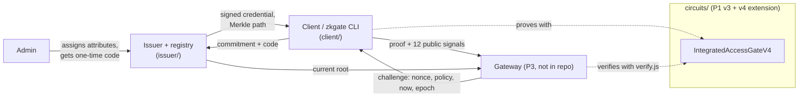

# P2 work — what was built, how it fits together, how to run it

This document describes everything in this repository that came out of the P2 (identity) work: what
P1's circuit provided, what was added on top of it, how each part works, how to run and test it,
the evidence that it works, and what is still open. For the plan and the per-task history see
[`plan/p2-plan.md`](plan/p2-plan.md) and [`plan/README.md`](plan/README.md); for the formal checkpoint
see [`gates/G1/summary.md`](gates/G1/summary.md).

---

## 1. The idea in one paragraph

An employee holds a credential signed by the company. To open a service (Wiki, File Share, Admin
Panel) their machine produces a **zero-knowledge proof**: "my credential is genuine, it is still on the
list of valid credentials, it satisfies this service's rule, and this proof answers your fresh
challenge". The gateway checks the proof in a few milliseconds and learns only *allowed* or *denied*
— not the name, role, department or clearance.



---

## 2. Starting point: P1's circuit (v3)

P1 delivered `circuits/integrated_access_v3.circom` and three components
(`components/access_policy.circom`, `eddsa_verifier.circom`, `merkle_membership.circom`) plus an input
generator (`scripts/generate_integrated_v3.js`). It was imported **unchanged**.

What v3 proves: knowledge of `credentialSecret` and `credentialSalt` behind
`commitment = Poseidon(secret, salt)`; a valid EdDSA issuer signature over that commitment; membership
of the commitment in a depth-2 Poseidon Merkle tree with a public `root`; and a fixed File Share rule.

Measured before any change (circom 2.2.3): 8116 non-linear + 1529 linear constraints at the default
level, 4935 at `--O2`. Gaps against the scope, all confirmed by tests (`plan/p2-plan.md` §1):

| Gap | Effect |
|---|---|
| G-1 attributes not in the signed message or the leaf | a credential holder could change role/clearance (demonstrated) |
| G-2 issuer key was a private input | a self-signed credential satisfied the circuit |
| G-3 policy hard-coded to File Share | one circuit per service |
| G-4 no expiry · G-6 no nonce, resource, epoch or nullifier | expired credentials and replays not stopped, no rate limiting |
| G-5 depth 2 | 4 users |
| G-7 no department · G-8 no range checks · G-9 no tests, one broken fragment · G-10 random issuer key per run | |

v3 stays in the repository as P1's baseline, with its own test suite; it is **not** admissible at a
gateway (safety test F2.12).

---

## 3. What was added

### 3.1 The v4 circuit — `circuits/integrated_access_v4.circom`

Built **next to** P1's files (her components are reused, never edited). New components in
`circuits/components/`:

| Component | What it adds | Closes |
|---|---|---|
| `attribute_hash.circom` | `attrHash = Poseidon(role, dept, clearance, deviceCompliant, employeeActive, expiry, commitment)` is both the signed message and the tree leaf; range checks on attributes | G-1, G-7, G-8 |
| `issuer_key.circom` | issuer key is a **public** input; on-curve checks for the key and the signature point | G-2 |
| `access_policy_v4.circom` | one generic policy: public role mask, department mask, minimum clearance, device requirement; `employeeActive` always required | G-3 |
| `expiry.circom` | `expiry > now`, both range-checked to 64 bits | G-4 |
| `challenge_binding.circom` | public `nonce`, `resourceId`, `epoch`; output `nullifier = Poseidon(secret, resourceId, epoch)` | G-6 |
| `merkle_membership_n.circom` | P1's Merkle template with a depth parameter (depth 2 compiles to her exact R1CS) | G-5 |
| `integrated_access_v4_gate.circom` | wiring of all the above | |

v4 at depth 16 (65,536 users): **9208 constraints** at `--O2`. Public signals, in this order:
`nullifier, root, issuerAx, issuerAy, roleMask, deptMask, minClearance, requireDevice, now, nonce,
resourceId, epoch` (contract `access.public_signals v4` in [`CONTRACTS.md`](CONTRACTS.md)).

### 3.2 Shared encoder — `circuits/lib/`

One JavaScript library used by the issuer, the client and the tests, so all of them hash and encode
exactly as the circuit does: commitments, attribute hashes, nullifiers, signatures, the Merkle tree
(`@zk-kit/incremental-merkle-tree` 1.1.0), circuit inputs for v3 and v4, the public-signal codec and a
local policy pre-check. Role and department numbers: engineer 0, admin 1, contractor 2, finance 3;
engineering 0, it 1, operations 2, finance 3 (ADR 0008).

### 3.3 Trusted setup, keys and verifier — `circuits/scripts/`, `circuits/setup/`

- Setup scripts (`setup.sh`, `ptau.sh`, `prove.sh`, `verify.sh`, `artifacts.sh`).
- **Phase 1:** PSE's public Perpetual Powers of Tau, prepared from contribution 0080 (62 contributions
  in its transcript). The Hermez files are no longer downloadable. The file's transcript contains the
  two challenge hashes PSE published for contribution 0080.
- **Phase 2:** one contribution (ours). The keys are therefore labelled **DEV-ONLY** until the team
  ceremony (`circuits/scripts/ceremony.sh`, see the note to P1/P3).
- Committed: v3 and v4 proving keys (`.zkey`), witness generators (`.wasm`), verification keys and
  manifests — so the client can prove from a fresh clone.
- `verify.js`: a fast verifier (median 5.6 ms) that also rejects non-canonical public signals,
  off-curve and out-of-subgroup points; `ZKGATE_VERIFY_IMPL=snarkjs` falls back to stock snarkjs.
- `circuits/fixtures/v4/`: 11 ready-made proofs — 5 valid, plus stale root, forged issuer, old `now`,
  same-epoch nullifier and wrong service — each mapped to the gateway check that must reject it.

### 3.4 Issuer and registry (M1, M2) — `issuer/`

A Node service (ADR 0003).

- **Enrolment, admin-approved:** the admin creates an enrolment with the employee's attributes and
  gets a one-time code (192-bit, stored hashed, single use, expires). The employee's app sends only its
  commitment and the code. The issuer signs the admin's attributes — the user cannot choose them — and
  never sees the secret or salt.
- At most one live credential per employee; a revoked employee needs a new admin enrolment.
- **Registry:** depth-16 Poseidon tree; issuing inserts a leaf; revoking sets it to zero; `GET /root`,
  `/root/history` (30-second staleness window that never re-admits across a revocation), `/path`.
- **Admin API:** enrolments, leaf list, tree for drawing, live root-change events (SSE).
- Fails closed: will not start without `ISSUER_ADMIN_TOKEN`; key directory must be private (0700).
- Logs hold no commitment, attributes, enrolment codes, employee IDs or key material.
- Persona seeding for the demo: `issuer/scripts/seed-personas.js` (Alice engineer, Bob contractor,
  Carol admin).

### 3.5 Client prover (M4) — `client/`

- Wallet: secret and salt generated locally, files mode 0600, written atomically, never sent.
- Pins the issuer key; checks the signature and the Merkle path before storing a credential.
- Fetches a challenge, checks the policy locally (refuses with reasons — e.g. Bob → Admin Panel),
  builds the input in memory, proves (about 1 s), verifies locally, submits.
- `zkgate` CLI: `keygen`, `request --code`, `status`, `prove`; a library API for the demo UI.

### 3.6 Attack Lab scripts — `client/attacks/`

Nine scripted attacks for the demo's Attack Lab and the gateway's tests: honest baseline, replay,
expired replay, revoked user, tampered attributes, forged credential, wrong service, spam (same
nullifier twice in one epoch), expired credential. Each produces the exact request and the expected
rejection code (a **proposal** for P3: `NONCE_USED`, `ROOT_NOT_CURRENT`, `ISSUER_NOT_PINNED`,
`POLICY_MISMATCH`, `CHALLENGE_MISMATCH`, `PROOF_INVALID`, `RATE_LIMITED`, …).

### 3.7 Safety test tier — `tests/safety/`

One file per security floor of the project (`docs/strategy.md` §6), reusing the real code. Append-only:
a meta-test fails if any test is removed. Reviews: [`security/review-G1-P2.md`](security/review-G1-P2.md),
[`gates/G1/floors.md`](gates/G1/floors.md).

---

## 4. Decisions

Recorded as ADRs in [`adr/`](adr/): 0002 adopt P1's v3 as the base; 0003 Node for issuer and registry;
0004 one shared encoder; 0005 keep P1's commitment with salt, nullifier from the secret; 0006 the v4
attribute hash; 0007 v4 public signals, `employeeActive` always required; 0008 role/department
numbers; 0009 commit the proving keys.

---

## 5. Evidence

| What | Result | Where |
|---|---|---|
| All tests (`npm run test:all`) | circuits 874 · issuer 174 (+1 skipped by design) · client 87 · Attack Lab 27 · safety 83 (79 pass, 4 waiting for the gateway) — 0 failing | [`gates/G1/summary.md`](gates/G1/summary.md) |
| Every v4 constraint has a test that fails if it is removed | 102 / 102 mutants killed; no unchecked `<--` | [`../circuits/reports/mutation-v4.md`](../circuits/reports/mutation-v4.md) |
| Circuit, issuer and client compute identical values | 263 values cross-checked | `issuer/test/crosscheck.v4.test.js` |
| Proving time (target < 3 s) | median 942 ms | [`../circuits/reports/perf-v4.md`](../circuits/reports/perf-v4.md) |
| Verify time (target < 10 ms) | median 5.6 ms | same |
| Proof size (target ~200 B) | 256 B | same |
| Coverage | unit 95–99 % per package; integration ~90 % | gate summary, Tests |
| Security review | Floors APPROVE (P2 lane); HIGH finding SR-03 (open enrolment) found and fixed | [`gates/G1/floors.md`](gates/G1/floors.md) |
| G1 checkpoint | CONDITIONAL — nothing failed; conditions are team / other-lane work | [`gates/G1/summary.md`](gates/G1/summary.md) |

---

## 6. How to run it

Prerequisites: Node ≥ 20 and circom **2.2.3** (`cargo install --git https://github.com/iden3/circom.git --tag v2.2.3 circom`).

```sh
npm ci && npm ci --prefix issuer
npm run test:all
```

The full walk-through (start the issuer, seed Alice/Bob/Carol, prove, verify, see Bob refused) is the
**Quick start** in the root [`README.md`](../README.md); it was run end to end.

---

## 7. Known limitations and what is still open

- **Keys are demo-only** until the multi-party phase-2 ceremony (whoever ran the single-party setup
  could forge proofs).
- **The gateway is not built yet.** The circuit alone does not stop replay, stale roots, forged issuer
  keys or rate-limit abuse; the gateway must enforce the eight obligations in `access.public_signals v4`.
- No CI pipeline and no `make test` / `make demo` yet.
- Fetching a Merkle path tells the registry which leaf is in use (privacy note SR-08); the client
  caches paths per root to limit this.

Who does what next: [`notes/next-steps-for-p1-and-p3.md`](notes/next-steps-for-p1-and-p3.md).
