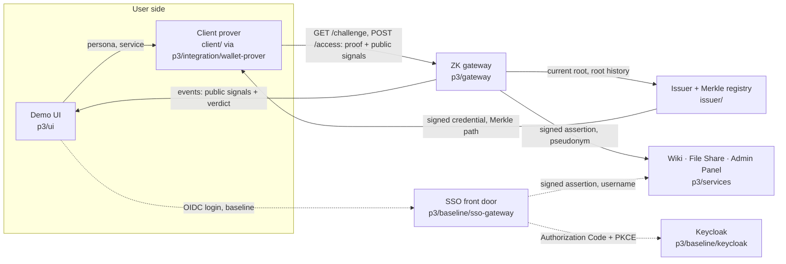

# ZK Access Gate — final report

Audience: course examiners and the demo panel. Each chapter starts with a plain explanation, then
the technical detail. Every number is taken from a committed file named next to it; a value with no
committed source is marked "not measured". The required contents come from
[`docs/project-scope.md`](../project-scope.md) ("Final deliverables", "Evaluation").

## Contents

1. [Problem](#1-problem)
2. [Background](#2-background)
3. [Design](#3-design)
4. [Circuit](circuit.md)
5. [Identity: issuer, registry, client prover](identity.md)
6. [Gateway, services and demo](gateway-and-demo.md)
7. [Threat model](../security/threat-model.md)
8. [Results](#8-results) ([P2 measurements](results-p2.md), [gateway benchmarks](gateway-and-demo.md#8-benchmark-results))
9. [Privacy comparison](privacy-comparison.md)
10. [Limitations](#10-limitations)
11. [Future work](#11-future-work)

## 1. Problem

Normal access control (login, SSO, JWT) hands every server the user's identity, email and roles,
and leaves a log of who opened what. That log is a privacy risk and a target. We built a zero-trust
gateway that admits an employee to an internal service on a zero-knowledge proof that their
company-signed credential is valid, not revoked and satisfies the service's policy, so the gateway
learns "allowed" or "denied" and nothing about who asked.

## 2. Background

Zero-knowledge proofs, Groth16, circom, Poseidon, EdDSA on BabyJubJub, Merkle trees, nullifiers,
OIDC and Keycloak are explained for a non-specialist in
[`docs/technology-explained.md`](../technology-explained.md). The project brief is
[`docs/project-scope.md`](../project-scope.md).

## 3. Design

Solid lines are the ZK path; dashed lines are the Keycloak baseline guarding the same services.
Module boundaries and data flows: [`docs/design.md`](../design.md). Interfaces (credential format,
public-signal order, gateway obligations, issuer API): [`docs/CONTRACTS.md`](../CONTRACTS.md).
Decisions: [`docs/decisions.md`](../decisions.md) and `docs/adr/`.

## 4–7. Chapters

- [Circuit](circuit.md): what the v4 circuit proves, 9208 constraints at depth 16, mutation testing.
- [Identity](identity.md): issuer, registry and revocation, client prover.
- [Gateway, services and demo](gateway-and-demo.md): how the gateway enforces the eight contract
  obligations, the services, the five demo screens, Keycloak baseline, Docker, benchmarks.
- [Threat model](../security/threat-model.md): malicious user, malicious issuer, compromised gateway,
  network attacker, insider abuse.

## 8. Results

**Performance.** Circuit-level measurements (proving, verify, proof size, constraints) and their
comparison with the scope targets: [`results-p2.md`](results-p2.md). System-level measurements
(v4 proving through the client, gateway verify, challenge → admit, per-request cost with a session,
SSO per-request cost): [gateway chapter, section 8](gateway-and-demo.md#8-benchmark-results), from
[`p3/bench/results/latest.json`](../../p3/bench/results/latest.json). Headline (median / p95, that
file): v4 proving 785.66 / 1007.86 ms, gateway verify 12.23 / 14.48 ms, challenge → admit
803.55 / 1035.17 ms, request with a ZK session 1.90 / 3.05 ms against 2.72 / 5.69 ms for SSO. The
Keycloak login round trip, browser proving and proving vs tree depth are not measured.

**Security test checklist** (scope, "Security tests"). Floor tests are registered in
[`tests/safety/MANIFEST.json`](../../tests/safety/MANIFEST.json); attacks are the
[`client/attacks`](../../client/attacks/README.md) ids, each run against the real gateway by
[`p3/gateway/tests/team-v4.e2e.test.ts`](../../p3/gateway/tests/team-v4.e2e.test.ts).

| Scope test | Floor tests | Attack id | Gateway tests (`p3/gateway/tests/full-profile.integration.test.ts`) |
|---|---|---|---|
| Valid user + satisfied policy → granted | F2.00, F3.06 | `baseline` | "valid user + satisfied policy → granted" |
| Policy not satisfied → no valid proof possible | F2.06, F2.07 | `wrong_service` | "replay → 409; nonce/resource/epoch/policy/issuer/time mismatches are denied" |
| Replayed proof → denied | F4.01–F4.05, F4.06 (gateway) | `replay`, `replay_expired` | same test; "expired nonce → NONCE_EXPIRED" |
| Revoked credential → denied | F3.01–F3.08, F3.10, F3.09 (gateway) | `revoked` | "revocation: a root change invalidates already-issued sessions"; staleness tests; cache regression in `registry-artifacts.test.ts` |
| Tampered attribute → denied | F2.01, F2.02, F2.10, F2.13 | `tamper` | "invalid proof → denied" |
| Forged issuer signature → denied | F2.03, F2.04, F2.05 | `forged` | issuer mismatch in the mismatch test |
| Expired credential → denied | F2.08, F2.09, F2.11, F4.04 | `expired` | time mismatch in the mismatch test |
| Same nullifier twice in one epoch → rate-limited | F5.01–F5.03, F5.08, F5.07 (gateway) | `spam` | "duplicate nullifier in the same epoch → rate limited (429)"; "concurrent duplicate nullifiers" |
| Different services → nullifiers unlinkable | F5.04, F5.05, F5.06 | — | — |
| Every circuit constraint has a negative test | F1.01–F1.09 | — | — |

Floor 1 evidence: [`circuits/reports/mutation-v4.md`](../../circuits/reports/mutation-v4.md) records
102 mutants, 102 killed, 0 survived, baseline 350 tests passing. Privacy floors (6, 7) are covered in
the [privacy comparison](privacy-comparison.md).

**Safety tier status.** F3.09, F4.06, F5.07 and F7.05 are the gateway halves of floors 3, 4, 5
and 7.

<!-- SAFETY-COUNTS -->

**Continuous integration.**

<!-- CI-STATUS -->

## 9. Privacy comparison

[`privacy-comparison.md`](privacy-comparison.md): the scope's table filled with evidence. In short,
the SSO front door publishes username, email, roles, department and clearance with every decision;
the ZK gateway records public signals and a verdict, and its only per-user value (the nullifier)
links requests within one service and 10-minute epoch only.

## 10. Limitations

### Trusted setup

Groth16 needs a circuit-specific setup whose leftover secret could forge proofs. The committed v4
keys are **DEV-ONLY**: phase 1 is a public ceremony (PSE Perpetual Powers of Tau, contribution
0080, power 15) and phase 2 is a **single local contribution plus a beacon**
([`circuits/setup/integrated_access_v4.manifest.json`](../../circuits/setup/integrated_access_v4.manifest.json),
fields `ptau` and `phase2`). Whoever ran phase 2 could forge proofs, so the keys are for tests and the
demo only; the gateway accepts them only with `ALLOW_DEMO_KEYS=true`, which production mode refuses.
(The circuit chapter, section 4, describes an earlier locally generated phase 1; the manifest is the
current record.)

<!-- CEREMONY-RESULT -->

### Other limitations

- **Gateway verify is over the 10 ms target** with stock snarkjs (12.23 ms median,
  `p3/bench/results/latest.json`); the faster verifier from [`results-p2.md`](results-p2.md) is not
  wired into the gateway.
- **Single-instance, in-memory gateway state.** Challenges, nullifier counters and sessions live in
  process memory (`p3/gateway/src/security/challenges.ts`); a restart forgets them, and several
  gateway replicas would need shared atomic state.
- **Not measured:** Keycloak login round trip, browser proving, proving vs depth, v4 server-side
  challenge + verify without proving (gateway chapter, section 8). Benchmarks ran on one laptop
  (P3) and one shared sandbox (P2); they are indicative.
- **Credentials are transferable**; the issuer is trusted on first use by the client; the issuer
  learns attributes at enrolment; one issuer key, no rotation ([`identity.md`](identity.md), section 6).
- **No TLS** in the demo (localhost / compose network) and development secrets in
  `p3/docker-compose.yml`.
- **The demo prover is a Node service** (`p3/integration/wallet-prover`) standing in for the user's
  machine, not the browser.
- **Privacy caveats** (issuer labels through the operator console, network metadata, small anonymity
  sets): [privacy comparison, section 3](privacy-comparison.md#3-where-the-claim-stops-honest-caveats).

## 11. Future work

Nice-to-haves from [`docs/project-scope.md`](../project-scope.md):

| # | Item | Status |
|---|---|---|
| N1 | In-browser proving | not done (`prove-browser` blocked in `p3/bench/results/latest.json`) |
| N2 | Accountable anonymity (identity escrow) | not done |
| N3 | Live metrics dashboard | partial: the Live View streams gateway events with verify times and the Performance page shows committed benchmark results; no real-time charts of requests or denials |
| N4 | Real device posture | not done (device compliance is an issuer-set attribute) |
| N5 | PLONK / Noir comparison | not done |
| N6 | Network-level gate (WireGuard) | not done |
| N7 | Merkle root transparency log | not done |
| N8 | Mobile prover | not done |

Beyond the list: a multi-party phase 2 ceremony (task G2-S1-CIRC-040), the fast verifier in the
gateway, shared persistent gateway state, TLS everywhere, and a Keycloak login benchmark.
