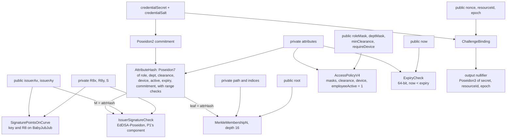

# Report chapter: the access circuit

Audience: the course and demo panel. Each section starts with a plain explanation, then the
technical detail. Every number is taken from a committed file, named next to it.

## 1. What the circuit is for (plain version)

The gateway must decide "may this person open this service?" without learning who the person is.
The user therefore does not send a name or a token. They send a **proof**: a short mathematical
object that convinces the gateway of one sentence.

> I know a secret that matches a credential the company signed; that credential is on the current
> list of valid credentials; its attributes satisfy this service's policy and it has not expired;
> and this proof belongs to your fresh challenge.

The **circuit** is the program that defines exactly what that sentence means. A proof exists only if
every rule in the circuit holds for the user's private data. If one rule fails, no proof can be made
at all. We use circom 2.2.3 and Groth16 (snarkjs). Source: `circuits/`.

## 2. Where we started: P1's v3 circuit

`circuits/integrated_access_v3.circom` (teammate P1, imported unchanged as the base, ADR 0002).

**What v3 proves.** The user knows `credentialSecret` and `credentialSalt` whose Poseidon hash is the
credential commitment; the issuer's EdDSA signature is valid over that commitment; the commitment is
a leaf of a Merkle tree with the public `root`; and a fixed "File Share" policy holds (role in
{2,3}, clearance in {2,3}, device compliant, employee active).

**What v3 exposes.** One public signal, `root` ([`circuits/README.md`](../../circuits/README.md)).
Size: 8116 non-linear + 1529 linear constraints at the circom default `--O1`, and 4935 at `--O2`
(same file; 4935 is the level of the v3 DEV key, [`circuits/setup/README.md`](../../circuits/setup/README.md)).

**Honest gaps.** Measured against the project scope on 2026-11-08
([`docs/plan/p2-plan.md`](../plan/p2-plan.md) section 1):

| # | Gap in v3 | Consequence | Closed in v4 by |
|---|---|---|---|
| G-1 | Attributes are not in the signed message or the leaf | Anyone can change role/clearance and keep the signature: a contractor can claim "admin" | `attrHash` is signed and is the leaf |
| G-2 | Issuer key `Ax, Ay` is a private input | A self-signed credential verifies; the gateway cannot pin the issuer | issuer key is a public input (the gateway pins it) |
| G-3 | Policy hard-coded to File Share | One circuit and key per service | policy as public inputs (masks) |
| G-4 | No `expiry` / `now` | Expired credentials keep working | `ExpiryCheck` |
| G-5 | Tree depth 2 | 4 users at most | depth 16 (65 536) |
| G-6 | No nonce, resource id, epoch, nullifier | Replay possible, no rate limit | `ChallengeBinding` |
| G-7 | No `dept` attribute | Policies cannot use department | `dept` added |
| G-8 | No range checks on attributes | Out-of-range values could satisfy a comparator | range checks in each component |
| G-9 | No tests; a fragment (`components/integrated_access.circom`) that does not compile | Floor 1 cannot be shown | test suite, mutation harness |
| G-10 | Random issuer key on every generator run | No stable issuer identity | persistent issuer key (identity chapter) |

G-1 and G-2 are kept visible on purpose: `circuits/test/v3.test.js` has tests titled
`GAP G-n (v3 only, closed in v4 ...)` that assert v3's insecure behaviour, and the matching
negatives live in `circuits/test/v4.test.js` (`circuits/README.md`). v3 is a pipeline baseline, not
the product.

## 3. The v4 circuit (the product)

`circuits/integrated_access_v4.circom` instantiates `IntegratedAccessGateV4(16)`; the template is in
`circuits/components/integrated_access_v4_gate.circom` (wiring only: no `<--`, no `===` of its own).
Her `IssuerSignatureCheck` is reused unchanged; the new rules are components beside hers (ADR 0002).
Decisions: ADR 0006 (attribute hash), 0007 (public-signal order, `employeeActive`), 0008 (enums).

### 3.1 Components

| Component | File | Job |
|---|---|---|
| `AttributeHash` | `circuits/components/attribute_hash.circom` | `attrHash = Poseidon(7)(role, dept, clearance, deviceCompliant, employeeActive, expiry, commitment)`; role/dept/clearance 2-bit, flags boolean |
| `IssuerSignatureCheck` | `circuits/components/eddsa_verifier.circom` | P1's EdDSA-Poseidon check, unchanged; message is `attrHash`, key is the public issuer key |
| `SignaturePointsOnCurve` | `circuits/components/issuer_key.circom` | issuer key and `R8` lie on BabyJubJub |
| `MerkleMembershipN` | `circuits/components/merkle_membership_n.circom` | her Merkle body with depth as a parameter; the leaf is `attrHash` |
| `AccessPolicyV4` | `circuits/components/access_policy_v4.circom` | role and dept in the masks, `clearance >= minClearance`, device if required, `employeeActive === 1` |
| `ExpiryCheck` | `circuits/components/expiry.circom` | both values 64-bit ranged, then `now < expiry` (`expiry == now` counts as expired) |
| `ChallengeBinding` | `circuits/components/challenge_binding.circom` | `nullifier = Poseidon(3)(secret, resourceId, epoch)`; `nonce * nonce` so the nonce sits in a constraint |

### 3.2 The statement

For public `(root, issuerAx, issuerAy, roleMask, deptMask, minClearance, requireDevice, now, nonce,
resourceId, epoch)` the prover knows the private inputs of section 3.3 such that:

1. `commitment = Poseidon(2)(secret, salt)`.
2. `attrHash = Poseidon(7)(role, dept, clearance, deviceCompliant, employeeActive, expiry, commitment)`.
3. `(R8, S)` is a valid EdDSA-Poseidon signature on `attrHash` under `(issuerAx, issuerAy)`; key and `R8` are on the curve.
4. `attrHash` is a leaf under `root` along `pathElements`/`pathIndices`.
5. Role and dept are in the policy masks, `clearance >= minClearance`, `deviceCompliant` if `requireDevice`, `employeeActive = 1`.
6. `now < expiry`.
7. The output is `nullifier = Poseidon(3)(secret, resourceId, epoch)`.

### 3.3 Inputs in contract order

Authoritative: [`docs/CONTRACTS.md`](../CONTRACTS.md) `credential v4` and `access.public_signals v4`.

- **Public signals** (snarkjs order: the output first, then the public inputs in declaration order;
  `circuits/test/v4.test.js` asserts it from the `.sym` file):

  | slot | 0 | 1 | 2 | 3 | 4 | 5 | 6 | 7 | 8 | 9 | 10 | 11 |
  |---|---|---|---|---|---|---|---|---|---|---|---|---|
  | name | nullifier | root | issuerAx | issuerAy | roleMask | deptMask | minClearance | requireDevice | now | nonce | resourceId | epoch |

- **Private inputs** (43): `credentialSecret, credentialSalt, role, dept, clearance,
  deviceCompliant, employeeActive, expiry, R8x, R8y, S, pathElements[16], pathIndices[16]`.

For comparison, v3 has one public signal (`root`) and 17 private inputs (`circuits/README.md`).

### 3.4 Constraint counts

From [`circuits/README.md`](../../circuits/README.md) (circom 2.2.3, circomlib 2.0.5; asserted by
`circuits/test/v4.test.js`), non-linear + linear:

| depth | `--O0` | `--O1` (default) | `--O2` |
|---|---|---|---|
| 8 | 10490 + 20801 | 10474 + 4231 | 7264 + 0 |
| **16** | 12458 + 25017 | 12442 + 6423 | **9208 + 0** |
| 20 | 13442 + 27125 | 13426 + 7519 | 10180 + 0 |

The product key is built at `--O2`: **9208 constraints** at depth 16
([`circuits/setup/README.md`](../../circuits/setup/README.md)). The depth 8 and 20 mains are
benchmark-only and are not keyed. For comparison v3 is 4935 at `--O2`. The scope said "expect
roughly 10k to 40k"; v4 at 9208 is just under that estimate (the scope calls its targets estimates
and asks us to report what we measure).

### 3.5 Floor 1 evidence: every constraint has a negative test

Floor 1: every circuit constraint has a negative test that fails when the constraint is removed, and
every `<--` is followed by an `===`.

- `npm run mutate:v4` mutates every constraint site of the v4 main, the gate and six v4 components
  (`===` deleted, or `<==` weakened to `<--`). A mutant counts as killed only by a failing test that
  exercises soundness; layout, constraint-count and "positives" tests are on a forbidden-killer list.
- Result ([`circuits/reports/mutation-v4.md`](../../circuits/reports/mutation-v4.md)): **95 mutants,
  95 killed, 0 survived**, 0 compile errors, 0 timeouts; the unmutated baseline passes 343 tests.
- `npm run audit:arrows` checks that every `<--` in the project circuits is followed by an `===` in
  its template (0 violations, recorded in the [plan](../plan/README.md) row for G1-S1-CIRC-036).
- `circuits/test/mutate.test.js` fails if the committed report is stale or records a survivor.
- P1's v3 files are not mutated by this harness; `circuits/test/v3.test.js` carries one-row tamper
  tests for them. Two boolean checks in her main are redundant (implied by `FileShareAccess`), so
  removing them admits no new witness; a test documents that.
- Open: `safety` still has to confirm 7 redundant-but-killed mutants (plan row, G1-S1-CIRC-036).

### 3.6 How each Attack Lab attack is stopped

The circuit can only speak about the proof. Some attacks need the gateway to compare the proof's
public signals with its own state (`docs/CONTRACTS.md`, `access.public_signals v4`, obligations 1 to
8). The circuit alone does not deliver floors 2 to 5.

| Attack Lab case | Circuit | Gateway obligation | Fixture in `circuits/fixtures/v4/` |
|---|---|---|---|
| Tamper attributes (contractor edits role) | Stops it. The signature covers `attrHash`; an edited attribute changes the hash, the signature check fails, no proof exists | none | not a fixture: witness generation fails (`v4.test.js`) |
| Forged credential, self-signed | Partly. Under the real issuer key there is no proof; with the forger's own key as public input a proof exists | 2: pin `issuerAx, issuerAy` to the configured key | `forged_issuer_alice_wiki` |
| Valid user, wrong service | Stops the user's own request (Bob cannot prove the Admin Panel policy) | 4: policy and `resourceId` equal the requested service's (stops presenting a proof made for another service) | `wrong_service_alice_wiki_as_admin` |
| Expired credential | Stops it: `now < expiry` | 5: proof's `now` and `epoch` equal the stored challenge (skew 120 s); otherwise an old `now` revives an expired credential | `stale_now_alice_wiki` |
| Revoked user tries again | Partly. A revoked leaf is zero, so Bob has no path to the new root | 3: `root` is current (30 s window, never re-admits a revoked leaf) | `stale_root_bob_wiki` |
| Replay a captured proof | Does not stop it: a valid proof stays valid. It only binds `nonce` into a constraint | 6: nonce single-use and unexpired (TTL 120 s) | reuse of `alice_wiki` |
| Spam requests | Provides the handle: the nullifier is a fixed function of `(secret, resourceId, epoch)` | 7: `(nullifier, epoch)` admitted at most once | `same_epoch_a`, `same_epoch_b` |

Unlinkability (floor 5): one user gets unrelated nullifiers for different `resourceId` or `epoch`
(for example `alice_wiki` and `alice_file_share` differ); tested in `circuits/test/v4.test.js`.
[`circuits/fixtures/v4/README.md`](../../circuits/fixtures/v4/README.md) names the obligation that
must deny each fixture. Every fixture verifies cryptographically; the denial is the gateway's job.
At the commits this chapter describes, the gateway is not in this tree, so obligations 2 to 8 are
specified and fixtured but not yet demonstrated end to end.

## 4. Trusted setup

Groth16 needs a one-time, circuit-specific setup. Whoever knows its leftover secret ("toxic waste")
could forge proofs, which is why real systems run a multi-party ceremony.

What we did ([`circuits/setup/README.md`](../../circuits/setup/README.md)):

- Phase 1 (Powers of Tau) is **DEV-ONLY**: the public Hermez files were unreachable (HTTP 403) from
  the development sandbox, so `pot15_DEV-ONLY_final.ptau` came from a local ceremony.
- Phase 2 is **single-party**: one contribution plus a beacon with local randomness.
- The keys are committed so a clone can prove and verify offline (ADR 0009):
  `circuits/setup/integrated_access_v4.{zkey,wasm}`, the verification key and a manifest with
  versions, hashes and the public-signal order. All are labelled DEV-ONLY.
- Whoever ran the setup could forge proofs. Fine for tests and the demo; never for real use.

Future work: a multi-party phase 2 (task G2-S1-CIRC-040, which regenerates the fixtures in the same
commit), phase 1 from the Hermez ceremony (`PTAU_SOURCE=hermez`), and a publicly fixed beacon
(`BEACON_HASH`). The scope itself lists the single-party phase 2 as a known limitation.

## 5. Limits of this chapter

- Soundness of Groth16 and of the Poseidon and EdDSA primitives is assumed, not proved here.
- The circuit does not range-check `nonce`, `resourceId` or `epoch`; that is deliberate and moved to
  gateway obligations 4 to 7 (header of `challenge_binding.circom`).
- A v4 proof is half of the guarantee: the gateway must pin the issuer key and keep state.
