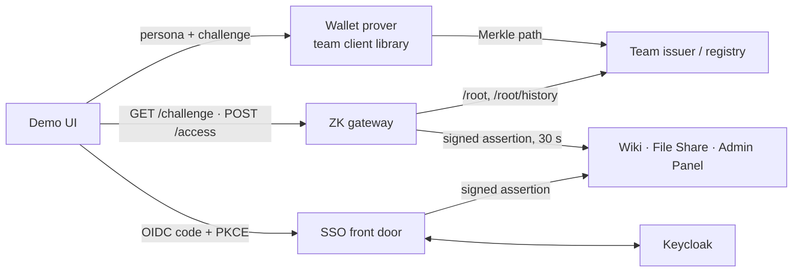

# Report chapter: the gateway, demo and SSO baseline (P3)

Audience: the course and demo panel. Each section starts with a plain explanation, then the technical
detail. Every number comes from a committed file or a test run named next to it; nothing is estimated.

## 1. What P3 is (plain version)

P1 built the circuit and P2 built the issuer and the client prover. P3 is what a user actually reaches.

- The **ZK gateway** sits in front of three internal services. It hands out fresh challenges, checks
  the proof that comes back, and lets the request through only if every check passes. It never learns
  who the user is.
- A **Keycloak SSO front door** guards the same three services in the normal way, so the two can be
  compared on the same requests.
- A **demo web app** with five screens makes this visible.
- **Packaging** covers Docker Compose, `make test` and `make demo`, and CI.

Code: `p3/` (gateway, services, UI, SSO baseline, adapters, benchmarks), the root `Makefile`,
`.github/workflows/ci.yml`, and the gateway half of the safety tier (`tests/safety/gateway.js` and four
tests).

## 2. Architecture

| Component | Where | Notes |
|---|---|---|
| ZK gateway | `p3/gateway` | Express + TypeScript (strict); snarkjs Groth16 verification; contract `access.public_signals v4` |
| Protected services | `p3/services` | Wiki, File Share, Admin Panel. They accept only requests carrying an HS256 assertion signed by a front door for *their own* audience, and they run on an internal network |
| SSO front door | `p3/baseline/sso-gateway` | Authorization Code + PKCE (S256); real JWKS validation; same policies |
| Keycloak realm | `p3/baseline/keycloak/realm-zkag.json` | Users alice, bob and carol; realm roles; `clearance`, `department` and `device_compliant` claims; audience mapper |
| Wallet prover | `p3/integration/wallet-prover` | User-side HTTP adapter over `client/src` (`prove`) and `client/attacks`; needs an operator session |
| Demo UI | `p3/ui` | React + Vite + Tailwind; User Portal, Gateway Live View, SSO vs ZK, Admin Console, Attack Lab, Performance |
| Packaging | `p3/docker-compose.yml`, `p3/docker/*`, `Makefile`, `.github/workflows/ci.yml` | Builds from the repository root; P1 and P2 code is used unchanged |

## 3. Authentication and authorization flow

**ZK path (authorization without identity).**

1. The UI asks the gateway for a challenge: `GET /challenge?resource=wiki`. The gateway returns
   `{nonce (128 random bits), resourceId, epoch = floor(now/600), now, policy}` and stores it with the
   nonce (TTL 120 s).
2. The holder's prover builds the v4 witness from the wallet (secret, salt, signed attributes, Merkle
   path from the issuer) and produces a Groth16 proof. The client library refuses up front if the
   policy is not met.
3. `POST /access {resource, nonce, proof, publicSignals}`. The gateway runs the pipeline in section 4.
   On success it sets a resource-scoped, HttpOnly, SameSite=Strict session cookie (10 minutes,
   `Path=/svc/<resource>`).
4. Each proxied request re-checks the session and the registry (see revocation), then forwards with a
   per-session pseudonym. The service learns "an anonymous credential holder was authorized" and nothing
   more.

**SSO path (the baseline).** `/sso/login` → Keycloak login page (PKCE S256, `state` bound to a cookie,
`nonce`) → `/sso/callback` exchanges the code with the client secret and `code_verifier`. The ID token
and access token are validated against the realm JWKS: algorithm allow-list, issuer, audience, expiry,
`azp`, and nonce. Every `/sso/svc/*` request **re-validates** the access token and evaluates the same
policy. The service receives the username.

## 4. ZKP verification and the eight gateway obligations

The circuit cannot check these eight things itself (`docs/CONTRACTS.md`, `access.public_signals v4`).
The gateway checks them in this order. Each refusal uses the team's code (`client/attacks/src/codes.js`).

| # | Obligation | Gateway check | Code |
|---|---|---|---|
| 6 | nonce issued here, unexpired, single use | atomic consume (synchronous check-and-set), TTL 120 s | `NONCE_UNKNOWN` / `NONCE_EXPIRED` / `NONCE_USED` |
| — | layout | strict schema, canonical decimals, 12 signals in contract order | `MALFORMED_REQUEST` |
| 2 | issuer key pinned | `issuerAx, issuerAy` equal the configured key, never fetched per request | `ISSUER_NOT_PINNED` |
| 3 | root current | **fresh** `/root` on every new authorization; a superseded root is accepted only if it was superseded ≤ 30 s ago and only by inserts (`/root/history`) | `ROOT_NOT_CURRENT` |
| 4 | policy and resource | `roleMask, deptMask, minClearance, requireDevice, resourceId` equal the requested service's | `POLICY_MISMATCH` |
| 5 | challenge binding | `now`, `epoch`, `nonce` equal the stored challenge (an old `now` would revive an expired credential) | `CHALLENGE_MISMATCH` |
| 1 | Groth16 | `snarkjs.groth16.verify` with the committed v4 key; manifest SHA-256 checked at start | `PROOF_INVALID` |
| 7 | rate limit | `(resource, epoch, nullifier)` admitted at most once; only verified proofs consume the budget | `RATE_LIMITED` |
| 8 | privacy | logs and state hold only public signals and decisions | see section 7 |

**Fail closed.** If the registry is unreachable the gateway answers 503. If the artefacts are missing
or don't match their manifest, if no issuer key is pinned, or if the key is unreviewed, the gateway
issues no session. The committed keys are `DEV-ONLY` (single-party phase 2, risk R-009). They are
accepted only with `ALLOW_DEMO_KEYS=true`, which production mode refuses; the UI header and
`/api/status` show "DEMO keys".

**Revocation and sessions.** A session survives enrolments (insert-only root changes) but is
invalidated as soon as any revocation happens after the root it was issued under.

## 5. Security controls

- Strict input validation: Zod schemas, 32 KiB body limit, canonical field elements.
- Per-IP rate limits, with a JSON error envelope.
- Helmet headers and CSP.
- CSRF: an Origin allow-list, JSON-only APIs and SameSite=Strict cookies.
- WebSocket event stream: requires an operator session and an allowed Origin.
- Reverse proxy:
  - upstreams come from configuration only;
  - traversal and encoded-traversal are rejected, and only canonical resource prefixes are accepted;
  - client `cookie`, `authorization` and `x-*` headers are stripped, as are upstream `set-cookie` headers.
- Operator authentication: constant-time token comparison and session rotation. The wallet prover's
  proving and attack endpoints also require an operator session.
- Production refusals: development secrets, non-Secure cookies and demo keys are all refused.

## 6. Keycloak and Docker

`make demo` (equivalent to `docker compose up --build` in `p3/`) starts these containers:

- Keycloak 26.0.7, which imports the realm;
- the team issuer (v4, state on a volume);
- a one-shot `setup` container, which enrols Alice, Bob and Carol through the admin enrolment flow and pins the issuer key;
- the services (internal network only);
- the gateway;
- the wallet prover;
- the SSO front door;
- the nginx UI on <http://localhost:8088>.

Use `localhost`, not `127.0.0.1`: Keycloak redirects back to `localhost:8088`, and the login-state
cookie is host-bound.

Verified on 2026-11-21 (macOS, Docker 29):

- the stack starts;
- `/api/status` reports `zkAuthorization: ready` and Keycloak healthy;
- a browser login as `alice` through the real Keycloak page succeeded;
- the same Wiki request was GRANTED through both front doors.

## 7. Security test methodology

All four gateway floor tests run the **real** components: the compiled gateway, the real snarkjs
verifier with the committed v4 key, the real issuer, the real client prover and the real Wiki. Nothing
is mocked. The issuer and gateway share one controllable clock, so the 120 s TTL, the epoch boundaries
and the 30 s window are tested exactly, without sleeping.

| Test | What it proves |
|---|---|
| F3.09 (`tests/safety/floor03`) | A revoked holder's pre-revocation proofs are `ROOT_NOT_CURRENT` immediately (inside the root cache window) and 60 s later; the earlier session is cut (401); no new proof can be made; an insert-only change does not lock anyone out |
| F4.06 (`floor04-05`) | Replay → `NONCE_USED`; 4 concurrent copies → exactly 1 admitted; accepted at exactly 120 s; `NONCE_EXPIRED` at 121 s; unknown nonces → `NONCE_UNKNOWN` |
| F5.07 (`floor04-05`) | A second proof in the same epoch → `RATE_LIMITED`; an invalid proof does not consume the budget; 3 concurrent → exactly 1; the next epoch changes the nullifier and admits once |
| F7.05 (`floor07`) | After a busy session (admissions, proxying, every denial, revocation, operator reads), the gateway log, event stream, operator events and in-memory state contain no identity/attribute/credential value or key; request logs carry no query strings or headers |

Further layers:

- `p3/gateway/tests/team-v4.e2e.test.ts` runs the team's **9 attack scripts** with real proofs against
  the gateway. `replay_expired` holds its proof 125 s on the injected clock instead of sleeping. It
  runs in under 1 s, and it fails if the TTL is lengthened: a mutation check with a 600 s TTL produced
  "expected NONCE_EXPIRED, got 200".
- `keycloak.live.test.ts` performs a real PKCE login by submitting Keycloak's form.
- Playwright drives the containerised demo, including the Keycloak login.

## 8. Test results (this branch, 2026-11-21)

| Suite | Command | Result |
|---|---|---|
| P3 (lint, format, typecheck, unit/integration/security) | `make test-p3` | **146 passed**, 5 skipped (the live-Keycloak tests, which run below) |
| Live Keycloak | `make test-keycloak` | **20 passed** (15 SSO + 5 live) |
| Safety floors | `npm test --prefix tests/safety` | **83/84 passed**, 0 todo; F8.05 fails without a native circom (see section 10) |
| Browser e2e (Docker demo + Keycloak) | `E2E_KEYCLOAK=1 make e2e` | **10 passed** |
| Client | `npm test --prefix client` | **87/87 passed** |
| Attack library | `npm test --prefix client/attacks` | **26/27 passed**; the 1 failure is macOS-only (section 10), same on clean `main` |
| Issuer | `npm test --prefix issuer` | **166 passed**, 1 pending, 4 failing: all four are the floor-8 cross-check, which compiles with circom (same on clean `main`) |
| Circuits | `npm test` | **not run locally**: refuses to start without a native circom 2.2.3; CI builds it |

## 9. Measured performance

From `p3/bench/results/latest.json`: 100 iterations each, Intel i9-9880H, Node 23.7, real proofs,
DEV-ONLY key.

| Metric | Median | p95 |
|---|---|---|
| v4 proving (client: path fetch + witness + Groth16 + local verify) | 785.7 ms | 1007.9 ms |
| v4 Groth16 verify (12 public signals) | 12.23 ms | 14.48 ms |
| v4 end to end: challenge → prove → admit (HTTP) | 803.6 ms | 1035.2 ms |
| Per request with a ZK session (root check + proxy) | 1.90 ms | 3.05 ms |
| Per request with SSO (JWT validation + policy + proxy) | 2.72 ms | 5.69 ms |
| Proof size | 256 B (uncompressed BN254) | — |
| v4 circuit | 9,208 constraints | — |

Against the scope targets: proving is under 3 s ✓; verification is under 10 ms ✗ (12.2 ms on this
laptop). The Keycloak login round trip, browser proving and depth scaling are not measured.

## 10. Limitations and remaining risks

- **Demo keys (R-009).** Phase 2 is single-party; the multi-party ceremony (G2-S1-CIRC-040) is
  outstanding. The gateway accepts these keys only in demo mode.
- **Single instance.** Challenges, nullifiers and sessions live in memory (atomic on Node's event
  loop). Scaling out needs a shared atomic store.
- **Demo wallets are server-side.** The wallet prover holds the personas' wallets for the demo. A real
  holder runs the client on their own machine. The prover therefore requires an operator session and
  must not be exposed publicly.
- **Local environment.** This Mac has no native circom (the Homebrew Rust build needs the Xcode
  Command Line Tools), so the circuit suite and floor-8 cross-checks were not run locally; CI builds
  circom 2.2.3. The attack CLI test truncates its output on macOS: `process.exit()` runs before piped
  stdout is flushed (reproduced: 200 KB written, 8 KB received). This is P2 code; it passes on Linux.
  The fix is to set `process.exitCode` instead of calling `process.exit()`.
- **Admin Console labels.** The operator-only `/api/admin/registry` passes the issuer's
  `employeeId` labels (from `issuer.admin` enrolments) to the Admin Console so the operator can revoke
  the right person. The gateway neither logs nor stores them (F7.05 checks the log, events and state).
- **Network privacy.** IP addresses and timing remain visible to every server; ZK hides identity at
  the application layer only.
- **Operator token.** The admin console uses a shared operator token; enterprise IAM is out of scope.
