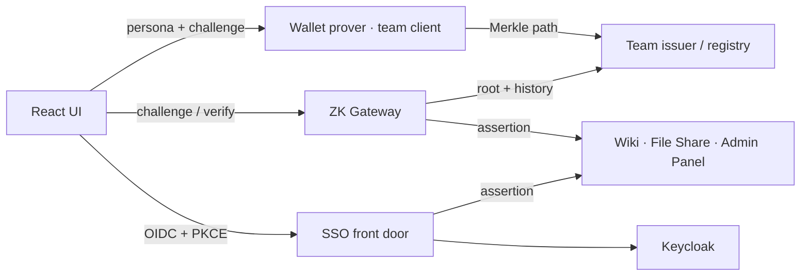

# ZK Access Gate — P3 (Gateway, Demo UI, SSO Baseline)

A zero-trust gateway that admits employees to internal services by verifying a **zero-knowledge proof** that they satisfy the service policy, with no identity sent to the gateway. A Keycloak SSO front door guards the same services for comparison.

P3 lives in `p3/`. It integrates the team's components **unchanged**:

- the circuit and keys in `../circuits`
- the issuer and registry in `../issuer`
- the client prover and attack suite in `../client`

> **Integration state.** The gateway runs the team circuit `integrated_access_v4` (depth 16, 12 public signals) and enforces all eight gateway obligations of `docs/CONTRACTS.md` (`access.public_signals v4`): pinned issuer key, insert-only root staleness rule, policy and `resourceId`, challenge `now`/`epoch`, single-use 128-bit nonce, and `(nullifier, epoch)` rate limit. Real access is granted end to end. The team's committed keys are **DEV-ONLY** (single-party phase 2), so the gateway accepts them only with `ALLOW_DEMO_KEYS=true`. The UI says so, and production mode refuses it.



## Quick start (local)

```bash
# once, at the repository root (team dependencies)
npm ci && npm ci --prefix issuer
# P3
cd p3
npm install
npm run v4:setup   # starts the team issuer, enrols Alice/Bob/Carol into wallets, pins the issuer key
npm run dev        # services, issuer :8100, gateway :4000, wallet prover :4700, SSO :4200, UI :5173
```

Open **http://localhost:5173** and sign in with `OPERATOR_TOKEN` from `env.example` (development value). For Keycloak, also run `docker compose up keycloak`. The demo users are `alice`, `bob` and `carol`; their development passwords are in `baseline/keycloak/realm-zkag.json`.

`npm run dev:v3` runs the earlier **diagnostic** profile instead: the P1 v3 circuit plus the P3 stand-in. It needs `npm run p1:build` and never grants access.

## Docker (full stack)

```bash
make demo        # from the repository root (= cd p3 && docker compose up --build -d)
```

UI <http://localhost:8088> (use `localhost`: Keycloak redirects there) · Keycloak <http://localhost:8080>. Builds from the repository root. A one-shot `setup` container enrols the personas and pins the issuer key before the gateway starts. The presentation script and recording plan are in [DEMO.md](DEMO.md); `make demo-reset` gives a fresh registry.

Root `make` targets: `make test` (every project suite incl. P3, needs circom 2.2.3), `make test-p3`, `make test-keycloak` (live Keycloak in Docker), `make e2e` (Playwright against the demo), `make help`.

## Commands

| Command                                                       | Does                                                                           |
| ------------------------------------------------------------- | ------------------------------------------------------------------------------ |
| `npm run v4:setup`                                            | team issuer + persona wallets + pinned issuer key (`.v4-demo/`, git-ignored)   |
| `npm run build`                                               | TypeScript builds + Vite production build                                      |
| `npm run typecheck` / `npm run lint` / `npm run format:check` | quality gates                                                                  |
| `npm test`                                                    | Vitest: unit, integration, security, **team issuer + attack suite end to end** |
| `npm run test:e2e`                                            | Playwright against a running stack (`E2E_BASE_URL`, default :5173)             |
| `npm run bench`                                               | 100-iteration benchmarks (v4 and v3) → `bench/results/latest.{json,csv}`       |
| `npm run p1:build` / `npm run p1:audit`                       | v3 diagnostic artifacts and audit (historical)                                 |

## Layout (`p3/`)

| Path                                                     | Contents                                                                                                                                              |
| -------------------------------------------------------- | ----------------------------------------------------------------------------------------------------------------------------------------------------- |
| `gateway/`                                               | Express gateway: challenges, Groth16 verification, contract obligations, sessions, proxy, events, admin; `/challenge` + `/access` for the team client |
| `services/`                                              | Wiki, File Share, Admin Panel (reachable only through a front door)                                                                                   |
| `baseline/`                                              | Keycloak realm + OIDC (Authorization Code + PKCE) front door                                                                                          |
| `ui/`                                                    | React demo: User Portal, Gateway Live View, SSO vs ZK, Admin Console, Attack Lab, Performance, Integration Status                                     |
| `integration/wallet-prover/`                             | User-side HTTP adapter over the team client (wallets, `prove`) and attack suite                                                                       |
| `integration/p2-standin/`                                | Diagnostic stand-in for the v3 profile only                                                                                                           |
| `bench/`, `contracts/`, `shared/`, `docker/`, `scripts/` | benchmarks, P3 API/manifest contracts, shared code, images, setup                                                                                     |

## Environment variables

All variables are documented in [env.example](env.example). With `NODE_ENV=production`, every component refuses development secrets; the gateway also refuses non-`Secure` cookies and `ALLOW_DEMO_KEYS`.
