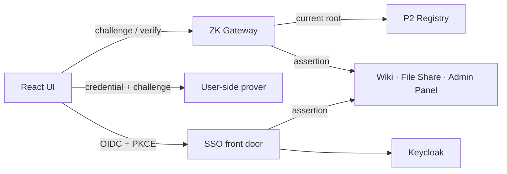

# ZK Access Gate — P3 (Gateway, Demo UI, SSO Baseline)

A zero-trust gateway that admits employees to internal services by verifying a **zero-knowledge proof** that they satisfy the service policy, with no identity sent to the gateway. A Keycloak SSO front door guards the same services for comparison.

P1's circuits live at the repository root (`../circuits`) and are **not modified** by anything in `p3/`.

> **Current integration state.** The P1 circuit (`integrated_access_v3`) compiles and produces real Groth16 proofs that this gateway verifies with snarkjs. An executed audit (`npm run p1:audit`) shows that the circuit **does not bind attributes or the issuer key, and has no nonce, resource, epoch or nullifier**. The gateway therefore runs it in **diagnostic mode**: it reports proof validity and **never grants access**. Real authorization switches on once the circuit provides those guarantees (`contracts/public-signals.zkag-access-v1.json`).



## Quick start (local)

```bash
cd p3
npm install
npm run p1:build        # compile P1's circuit (from ../circuits) + DEV-ONLY Groth16 setup
npm run p1:audit        # executed security audit → evidence/p1-audit-report.json
npm run p1:fixtures     # diagnostic personas for the P2 stand-in
npm run dev             # gateway :4000, services :4101-4103, SSO :4200, P2 stand-in :4600, UI :5173
```

Open **http://localhost:5173** and sign in with `OPERATOR_TOKEN` from `.env.example` (development value).

**Keycloak (SSO baseline):** with Docker running, start `docker compose up keycloak` alongside `npm run dev`. Demo users: `alice`, `bob`, `carol` (development passwords are in `baseline/keycloak/realm-zkag.json`).

**Full Docker stack:** `npm run p1:build && npm run p1:fixtures && docker compose up --build` → UI at http://localhost:8088.

## Commands

| Command                                 | Does                                                         |
| --------------------------------------- | ------------------------------------------------------------ |
| `npm run build`                         | TypeScript builds + Vite production build                    |
| `npm run typecheck`                     | strict type checks, all workspaces                           |
| `npm run lint` / `npm run format:check` | ESLint / Prettier                                            |
| `npm test`                              | Vitest unit, integration and security suites                 |
| `npm run test:e2e`                      | Playwright (with `npm run dev` running)                      |
| `npm run bench`                         | 100-iteration benchmarks → `bench/results/latest.{json,csv}` |
| `make demo` / `make reset`              | Docker demo / reset demo state                               |

## Layout (`p3/`)

| Path                      | Contents                                                                                                          |
| ------------------------- | ----------------------------------------------------------------------------------------------------------------- |
| `gateway/`                | Express gateway: challenges, Groth16 verification, sessions, reverse proxy, events, admin                         |
| `services/`               | Wiki, File Share, Admin Panel (reachable only through a front door)                                               |
| `baseline/`               | Keycloak realm + OIDC (Authorization Code + PKCE) front door                                                      |
| `ui/`                     | React demo: User Portal, Gateway Live View, SSO vs ZK, Admin Console, Attack Lab, Performance, Integration Status |
| `integration/p2-standin/` | **Diagnostic** stand-in for P2 (registry + prover over the real P1 circuit) and the P1 audit                      |
| `contracts/`              | Proposed OpenAPI (P2 registry/prover, gateway) and public-signal layouts                                          |
| `bench/`                  | Benchmark harness and measured results                                                                            |
| `shared/`                 | Policies, field encoding, events, front-door assertions, proxy hardening                                          |

## Integration contracts

- **P1:** `contracts/public-signals.zkag-access-v1.json` and `contracts/artifact-manifest.schema.json`
- **P2:** `contracts/p2-registry.openapi.yaml` (language independent; FastAPI is fine)

## Environment variables

All variables are documented in [.env.example](.env.example). With `NODE_ENV=production`, every component refuses development secrets, and the gateway refuses non-`Secure` cookies.
